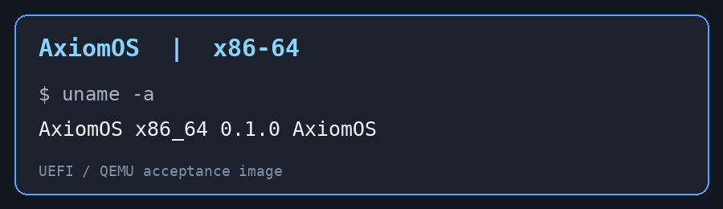
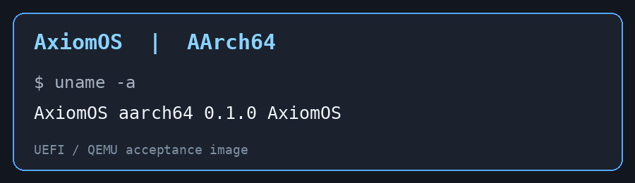
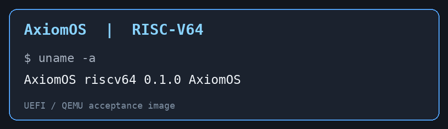
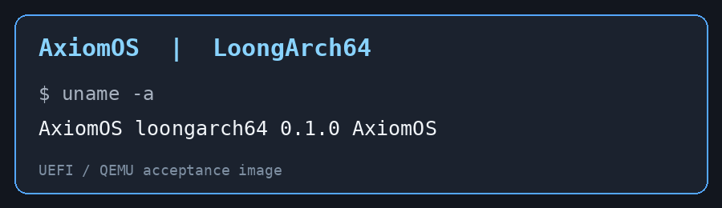

# AxiomOS

AxiomOS is a freestanding operating-system project written primarily in Ada 2022 and built with the Alire -> GNAT -> GPRbuild toolchain. The validation targets are x86-64, AArch64, RISC-V64 and LoongArch64 under UEFI/QEMU.

The boot path is a native UEFI menu, an independently linked Ada kernel ELF, ExitBootServices, physical-page and heap management, a VirtIO block device, a read-only EXT4 root filesystem, SMP bring-up, architecture-owned page tables, and a static Ada userspace. Architecture mechanisms live under arch/<isa>; shared policy lives in kernel/ and hal/; QEMU board discovery lives under platform/.

## Architecture validation

The following cards record the verified uname -a identity for each target image.

<table>
<tr>
<td></td>
<td></td>
</tr>
<tr>
<td></td>
<td></td>
</tr>
</table>

Each target builds the same common Ada kernel sources plus its own HAL backend and assembly mechanisms. The QEMU acceptance run checks the UEFI menu, kernel entry, MMU operations, clock, SMP, VirtIO, filesystem, I/O, drivers, syscalls, user isolation and resource reclamation.

## Build and test

Install the pinned tools described in toolchains/README.md, then run:

    alr -n build
    alr -n run
    scripts/build.sh --arch=all
    scripts/test-storage.sh
    scripts/test.sh

To run one target directly:

    python3 scripts/run-qemu.py --arch=x86_64 --cpus=4 --test
    python3 scripts/run-qemu.py --arch=aarch64 --cpus=4 --test
    python3 scripts/run-qemu.py --arch=riscv64 --cpus=4 --test
    python3 scripts/run-qemu.py --arch=loongarch64 --cpus=4 --test

The unified test script also accepts --arch=<target>, --cpus=<count>, --timeout=<seconds> and --host-only. It stores generated images and serial evidence under build/<target>/; those files are ignored by Git.

## Implemented subsystems

- UEFI menu and Boot_Info handoff for all four target architectures.
- Physical memory allocation, heap management, user address spaces, zero-filled mappings, W^X, protect/unmap and transactional rollback.
- SMP discovery and AP startup, per-CPU work mailboxes, bounded synchronization, jobs and run-queue data structures.
- Read-only FAT16, FAT32, NTFS, EXT2, EXT3 and EXT4 volume parsing. EXT4 is the default root filesystem; tmpfs provides writable memory-backed files.
- VFS mount routing, nested and busy-unmount checks, generation-tagged handles, rights attenuation, independent stream offsets, seek and stat.
- PCI discovery, driver lifecycle transitions and serialized modern VirtIO block reads with reset and DMA ownership checks.
- Static Ada userspace, four privilege-transition paths, checked user buffers, syscall dispatch and process-exit resource reclamation.

## Current boundary

This is a bootable and tested kernel foundation, not a finished production operating system. Disk filesystems are currently read-only; writable storage, journal replay and power-failure recovery are not implemented. Userspace runs sequentially on the BSP, and there is no preemptive scheduler, full interrupt-device framework, cross-core user scheduling or TLB shootdown. spawn, IPC and thread_yield remain unsupported. Hardware validation is limited to the documented QEMU/UEFI combinations; real-machine qualification has not been performed.

The project preserves the AxiomOS package namespace and follows GNAT's default Ada filename convention. No remote operation is performed by push.sh; it only previews or creates the local commits listed by its feature groups.
